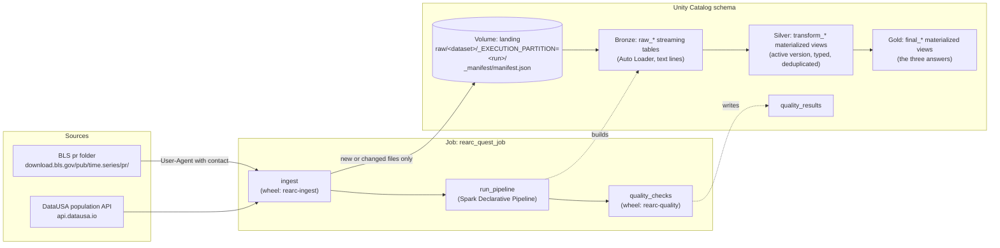

# Rearc Data Quest: Databricks Edition

A config-driven pipeline that lands the BLS Major Sector Productivity (`pr`) files and US population data from
DataUSA in a Unity Catalog Volume, then models them as Bronze, Silver and Gold tables with a Spark Declarative
Pipeline. It is deployed with a Databricks Asset Bundle.

- **Design reasoning, data findings, trade-offs and AI usage:** [PROCESS.md](PROCESS.md)
- **Screenshot evidence:** [docs/SCREENSHOTS.md](docs/SCREENSHOTS.md)

## Contents
1. [Architecture](#architecture)
2. [Repository layout](#repository-layout)
3. [Prerequisites](#prerequisites)
4. [Reviewer runbook](#reviewer-runbook)
5. [Verifying the results](#verifying-the-results)
6. [Running locally](#running-locally)
7. [CI/CD](#cicd)
8. [Logs and monitoring](#logs-and-monitoring)
9. [Troubleshooting](#troubleshooting)
10. [Cleanup](#cleanup)
11. [Known limitations](#known-limitations)

## Architecture


| Layer | Tables | Built by |
|---|---|---|
| Landing | Volume `landing`: every source file unchanged, plus the manifest | `rearc-ingest` |
| Bronze | `raw_bls_data`, `raw_bls_series`, `raw_bls_class`, `raw_bls_duration`, `raw_bls_footnote`, `raw_bls_measure`, `raw_bls_period`, `raw_bls_seasonal`, `raw_bls_sector`, `raw_population` | Pipeline |
| Silver | The same ten names with a `transform_` prefix, for example `transform_bls_data` | Pipeline |
| Gold | `final_population_stats`, `final_series_best_year`, `final_series_population_report` | Pipeline |
| Checks | `quality_results` | `rearc-quality` |

Every Bronze, Silver and Gold table carries six metadata columns: `_SOURCE_URI`, `_FILE_NAME`,
`_EXECUTION_PARTITION`, `_RAW_DATA_HASH`, `_INGESTED_AT` and `_PROCESSED_AT`. Their meanings are in
[PROCESS.md](PROCESS.md#architecture).

Three source files land but have no tables:
- **`pr.data.0.Current`:** a subset of `pr.data.1.AllData`, so modeling it would duplicate rows.
- **`pr.txt` and `pr.contacts`:** documentation.

## Repository layout
| Path | Purpose |
|---|---|
| `src/rearc_quest/config/dataset_config_definition.py` | All dataset and final-table config: sources, tables, transform methods, expectations, secret reference |
| `src/rearc_quest/ingestion/` | Directory listing, manifest, schema check, storage, sync |
| `src/rearc_quest/utils/spark_utils.py` | Reusable Spark functions used by every transform |
| `src/rearc_quest/transforms/` | Transform methods, plus the PySpark version of each answer (`final_tables.py`) |
| `src/rearc_quest/sql/` | The Spark SQL version of each answer, which is the primary version |
| `src/rearc_quest/quality/checks.py` | Post-pipeline checks: not empty, null keys, duplicate keys |
| `src/rearc_quest/jobs/` | Wheel entry points `rearc-ingest` and `rearc-quality` |
| `src/pipeline/definitions.py` | Registers every pipeline table from config |
| `databricks.yml` | Asset Bundle: schema, Volume, pipeline, job, and `dev` and `prod` targets |
| `scripts/profile_sources.py` | One-time local data profile |
| `tests/` | Unit tests; Spark tests need Java or Databricks Connect |
| `.github/workflows/` | CI, deploy and manual run workflows |

## Prerequisites
### On your machine
- **Git**
- **Python 3.11 or later** with `venv`. The project was developed with Python 3.13.
- **Databricks CLI**, a version that supports `databricks bundle`. It was tested with v1.23.0.

Java is not needed.

### In the Databricks workspace
The bundle was deployed and run on **Databricks Free Edition**. It should work on other workspaces that meet these
requirements, but it hasn't been tested on any other:

| Requirement | Why |
|---|---|
| Unity Catalog with a catalog you can create schemas in | The bundle creates a schema and a Volume. The default catalog is `workspace`, which Free Edition provides |
| Serverless jobs and serverless pipelines | The job uses a serverless environment and the pipeline sets `serverless: true` |
| Permission to create a secret scope | The BLS contact email is read from a secret |
| Outbound internet from serverless to `download.bls.gov` and `api.datausa.io` | Ingestion runs on serverless. Free Edition limits outbound access to trusted domains; both were reachable on 1-2 Nov 2026 |

## Reviewer runbook
All commands run from the repository root.

### 1. Clone and create a Python environment
```bash
git clone https://github.com/MaheshKhetpal06/rearc-data-quest.git
cd rearc-data-quest
python3 -m venv .venv
source .venv/bin/activate
pip install -e ".[dev]"
```
Keep the virtual environment active for the steps below. `databricks bundle deploy` builds the wheel with
`python -m build`, which `.[dev]` installs.

### 2. Log in to your workspace
```bash
databricks auth login --host https://<your-workspace-host> --profile DEFAULT
databricks current-user me
```
To use a profile other than `DEFAULT`, add `--profile <name>` to every `databricks` command below.

### 3. Provide your contact email for BLS
BLS rejects automated requests that don't identify a contact. The code builds the User-Agent
`rearc-data-quest/1.0 (contact: <email>)` and looks up the email in this order:
1. The environment variable `BLS_CONTACT_EMAIL`, which is used for local runs.
2. The Databricks secret `bls-contact-email` in scope `rearc-quest`, which is used by the job.

These names are fixed in `src/rearc_quest/config/dataset_config_definition.py`, which defines `BLS_CONTACT`.
Create the secret:
```bash
databricks secrets create-scope rearc-quest
databricks secrets put-secret rearc-quest bls-contact-email --string-value "you@example.com"
databricks secrets list-secrets rearc-quest
```

### 4. Validate and deploy to the development target
```bash
databricks bundle validate -t dev
databricks bundle deploy -t dev
databricks bundle summary -t dev
```
`dev` is the default target and uses development mode, which prefixes resource names with your user name.
`bundle summary` prints the real names. For example, on the author's workspace the schema was
`dev_mahesh_khetpal98_rearc_quest_dev` and the job was `[dev mahesh_khetpal98] rearc_quest_job`.

If your workspace has no `workspace` catalog, pass another catalog to every bundle command:
```bash
databricks bundle deploy -t dev --var="catalog=<your_catalog>"
```

### 5. Run ingestion, the pipeline and the quality checks
```bash
databricks bundle run quest_job -t dev
```
This runs the job's three tasks in order: `ingest`, `run_pipeline`, `quality_checks`. On Free Edition it took about
10 minutes, most of it serverless start-up and the pipeline update.

The job runs ingestion and the quality checks around the pipeline, because the pipeline only builds tables from
files already in the Volume. PROCESS.md explains why both are needed.

On a first run, the `ingest` task output lists every downloaded file, then ends like this:
```
INFO Ingestion <run_id> finished: {'added': 13}
INFO Run summary: run_id=<run_id> status=SUCCEEDED duration=...s added=13 changed=0 unchanged=0 removed=0
```
A second run should report `0 to download, 12 unchanged (skipped)` and `{'unchanged': 13}`, which shows that nothing
is downloaded or landed again. The `quality_checks` task output ends with:
```
INFO Run summary: status=SUCCEEDED duration=...s checks=39 passed=39 failed=0
39 of 39 checks passed
```

You can also run the parts separately:
```bash
databricks bundle run quest_pipeline -t dev                     # pipeline update only
databricks bundle run quest_pipeline -t dev --full-refresh-all  # rebuild every table from the Volume
databricks bundle run quest_job -t dev --only quality_checks    # quality checks only
```

### 6. Inspect the tables
Open the schema URL printed by `databricks bundle summary -t dev` in Catalog Explorer, or use the SQL editor with
the schema name from that summary:
```sql
USE CATALOG workspace;           -- or your catalog
USE SCHEMA <schema_from_summary>;
SHOW TABLES;
```
Expect 24 tables: 10 `raw_*`, 10 `transform_*`, 3 `final_*` and `quality_results`.

## Verifying the results
The expected values below come from the author's runs on 1-2 Nov 2026. BLS and DataUSA revise their data, so
later runs can differ.

### Gold 1: population mean and standard deviation, 2013-2018
```sql
SELECT min_year, max_year, years_included, mean_population, stddev_population
FROM final_population_stats;
```
Expected: `2013`, `2018`, `6`, `322069808.0`, `4158441.04`. The standard deviation is the sample standard
deviation; PROCESS.md explains why.

### Gold 2: best year per series
```sql
SELECT series_id, series_label, best_year, summed_value, quarters_in_best_year, has_quarterly_data
FROM final_series_best_year
ORDER BY series_id;

SELECT COUNT(*) AS series,
       SUM(CASE WHEN best_year IS NULL THEN 1 ELSE 0 END) AS annual_only_series
FROM final_series_best_year;
```
Expected: 282 series, 45 with a NULL `best_year` because they only have annual (`Q05`) data. Sample rows:

| series_id | best_year | summed_value |
|---|---|---|
| `PRS30006011` | 2022 | 16.400 |
| `PRS30006013` | 1989 | 578.369 |
| `PRS30006032` | 1994 | 14.600 |

`PRS30006032` has the label "Manufacturing - Hours worked - % Change from previous quarter (All workers)".

### Gold 3: PRS30006032, Q01, with population
```sql
SELECT series_id, year, period, value, population
FROM final_series_population_report
ORDER BY year;
```
Expected: 39 rows from 1988 to 2026, 11 with a population. Years without population data, such as 2020, have a
NULL population. Recent rows:

| year | value | population |
|---|---|---|
| 2020 | -7.000 | NULL |
| 2021 | 0.500 | 331893745 |
| 2022 | 5.300 | 333287562 |
| 2023 | 0.500 | 334914896 |
| 2024 | -0.700 | 340110990 |

### Row counts through the layers
```sql
SELECT 'raw_bls_data' AS table_name, COUNT(*) AS row_count FROM raw_bls_data
UNION ALL SELECT 'transform_bls_data', COUNT(*) FROM transform_bls_data
UNION ALL SELECT 'raw_population', COUNT(*) FROM raw_population
UNION ALL SELECT 'transform_population', COUNT(*) FROM transform_population;
```
Expected after one ingestion: 77,126 rows in both `raw_bls_data` and `transform_bls_data`, and 11 in both
population tables. Raw tables are append-only, so if a source file changes, raw keeps every version and transform
keeps only the latest.

### Metadata columns
```sql
SELECT _SOURCE_URI, _FILE_NAME, _EXECUTION_PARTITION, _RAW_DATA_HASH, _INGESTED_AT, _PROCESSED_AT
FROM final_series_best_year
LIMIT 1;
```
For a Gold table, `_FILE_NAME` lists every contributing file, for example `pr.data.1.AllData, pr.series`.

### Quality results and expectation metrics
```sql
SELECT * FROM quality_results WHERE NOT passed;   -- expected: no rows

SELECT split(origin.flow_name, '[.]')[2] AS flow,
       e.name AS expectation,
       SUM(e.passed_records) AS passed,
       SUM(e.failed_records) AS failed
FROM event_log('<pipeline_id>')
LATERAL VIEW explode(from_json(
  details:flow_progress.data_quality.expectations,
  'array<struct<name:string,dataset:string,passed_records:bigint,failed_records:bigint>>'
)) AS e
WHERE event_type = 'flow_progress'
  AND details:flow_progress.data_quality.expectations IS NOT NULL
GROUP BY 1, 2
ORDER BY 1, 2;
```
The pipeline ID is the last part of the pipeline URL in `databricks bundle summary`. On the author's run, every
expectation reported 0 failed records.

## Running locally
Local runs need no Databricks workspace except where noted.
```bash
source .venv/bin/activate
pytest            # Spark tests skip without Java or Databricks Connect
ruff check .

export BLS_CONTACT_EMAIL=you@example.com
python scripts/profile_sources.py .sample      # one-time data profile
rearc-ingest --volume-path .local_volume       # landing logic, writing to a local folder
```
Run `rearc-ingest` twice: the second run should report `{'unchanged': 13}`. `.sample/` and `.local_volume/` are
gitignored. You can also copy `.env.example` to `.env` and load it with `set -a; source .env; set +a`.

**Spark tests without Java.** Databricks Connect runs the Spark tests on serverless, using your `DEFAULT` profile.
It conflicts with plain `pyspark`, so it needs its own environment. With Python 3.13, `databricks-connect` 16.1
requires NumPy 1.x, hence the PyArrow pin.
```bash
python3 -m venv .venv-connect
.venv-connect/bin/pip install databricks-connect "pyarrow==18.1.0" pandas pytest requests databricks-sdk
.venv-connect/bin/python -m pytest tests/test_spark.py
```

**If serverless can't reach the sources.** Ingestion can run on your machine and upload to the Volume through the
Files API. This path exists in the code but hasn't been tested end to end.
```bash
rearc-ingest --use-files-api --volume-path /Volumes/<catalog>/<schema>/landing
databricks bundle run quest_pipeline -t dev
```

## CI/CD
| Workflow | Trigger | Does |
|---|---|---|
| `ci.yml` | Pull request, push to `main` | Lint, all tests including Spark (Java is set up on the runner), wheel build |
| `deploy.yml` | Push to `main`, manual | `bundle validate` and `bundle deploy`. Push deploys `prod`; manual runs choose `dev` or `prod` |
| `run_pipeline.yml` | Manual only | `bundle run quest_job`, kept manual to protect the Free Edition compute quota |

`deploy.yml` and `run_pipeline.yml` need the repository secrets `DATABRICKS_HOST` and `DATABRICKS_TOKEN`. In a fork
without them, Deploy fails at `bundle validate` with "cannot configure default credentials", while CI still passes.

On the author's repository, a push to `main` on 3 Nov 2026 ran CI and Deploy successfully, and Deploy updated `prod`.

## Logs and monitoring
| What | Where |
|---|---|
| Ingestion: sources, files discovered, each file's outcome, HTTP requests, run summary | Job run → `ingest` task → Output |
| Table build progress, row counts, expectation results | Pipeline page → latest update → a table's Data quality tab, or the event log (query in [Verifying the results](#verifying-the-results)) |
| Quality checks: one line per table and a run summary | Job run → `quality_checks` task → Output, and the `quality_results` table |
| Task status and duration | Job page → Runs |

The logs never contain credentials, the BLS contact email or HTTP headers. To find which files a run landed, look in
the Volume folder `raw/<dataset>/_EXECUTION_PARTITION=<run_id>/`, where `run_id` is the value in the run summary.

## Troubleshooting
| Symptom | Likely cause | Fix |
|---|---|---|
| `bundle validate` or `deploy`: "cannot configure default credentials" | No CLI login or profile | Run `databricks auth login`, or pass `--profile` |
| `bundle deploy` fails building the wheel | `python -m build` is unavailable | Activate the virtual environment that has `.[dev]` installed |
| Schema or Volume creation fails | Catalog `workspace` is missing, or you can't create schemas in it | Pass `--var="catalog=<your_catalog>"` |
| `ingest` task: "Set BLS_CONTACT_EMAIL, or create secret rearc-quest/bls-contact-email" | The secret is missing | Step 3 of the runbook |
| `ingest` task: "403 from https://download.bls.gov/..." | No contact sent, or serverless egress blocked | Check the secret. On restricted egress, use the local Files API route |
| `ingest` task: `SourceSchemaError` | A source file's columns no longer match config | Expected protection. Compare the file with config before changing anything |
| `ingest` task: `ListingError` | The BLS listing page had no files, for example during an outage | Re-run later. Nothing is marked as removed |
| Pipeline: `ModuleNotFoundError: No module named 'rearc_quest'` | The wheel isn't attached | Redeploy with `bundle deploy` so the wheel is rebuilt and uploaded |
| Pipeline fails on `all_six_years_present` | The population API no longer returns all of 2013-2018 | Check the API response. The pipeline stops rather than publishing a wrong answer |
| Job or pipeline stops on Free Edition | Daily compute quota reached, or another pipeline already active | Wait, or run one target at a time |

## Cleanup
```bash
databricks bundle destroy -t dev          # add --var="catalog=..." if you used one
databricks secrets delete-scope rearc-quest
```
`bundle destroy` removes the resources the bundle created: the job, the pipeline, the Volume and the schema.
Destroy hasn't been tested on this project. If the schema remains afterwards, drop it in the SQL editor with
`DROP SCHEMA <catalog>.<schema> CASCADE`.

## Known limitations
- **Tested on one workspace:** only Databricks Free Edition was used.
- **Single writer:** the manifest is a JSON file, so one ingestion at a time is assumed. The job sets
  `max_concurrent_runs: 1`.
- **Time-dependent values:** the expected values above depend on BLS and DataUSA data as of 1-2 Nov 2026.
- **Latest results only:** `quality_results` holds only the latest run. Earlier results are in each job run's
  `quality_checks` output.
- **Files API fallback:** the route that runs ingestion locally and uploads through the Files API hasn't been
  exercised end to end.

See [PROCESS.md](PROCESS.md) for trade-offs and what a production version would change.
